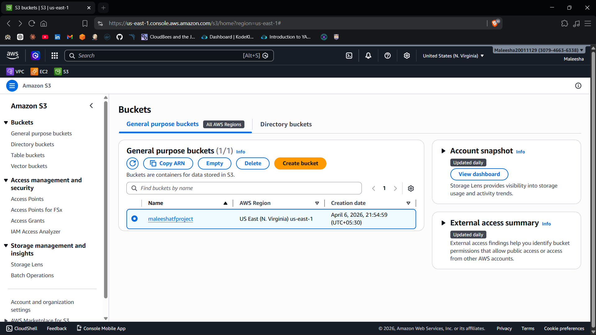
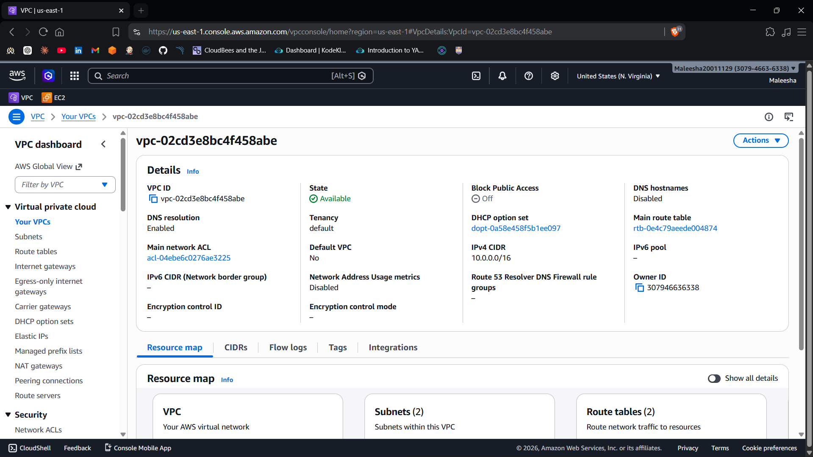
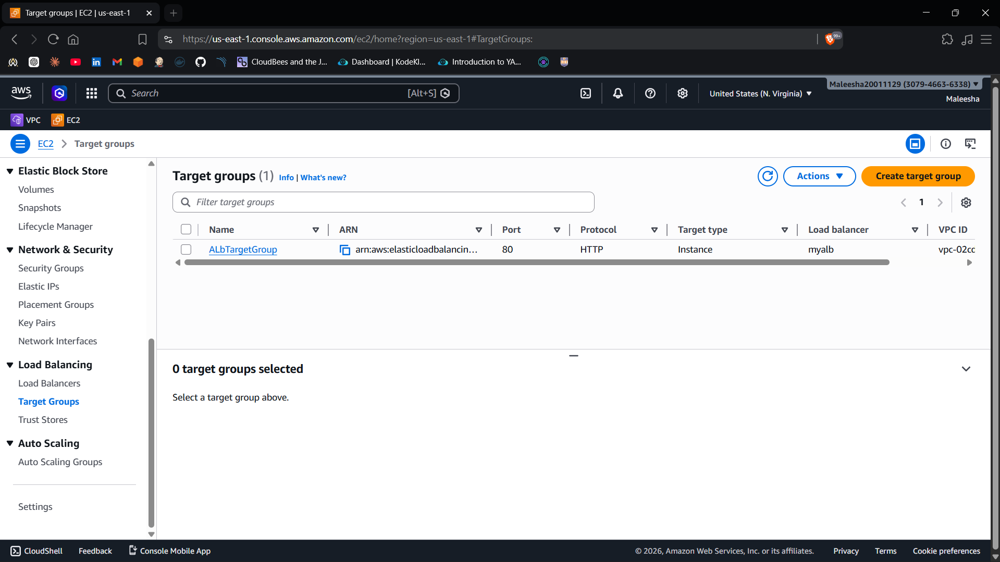
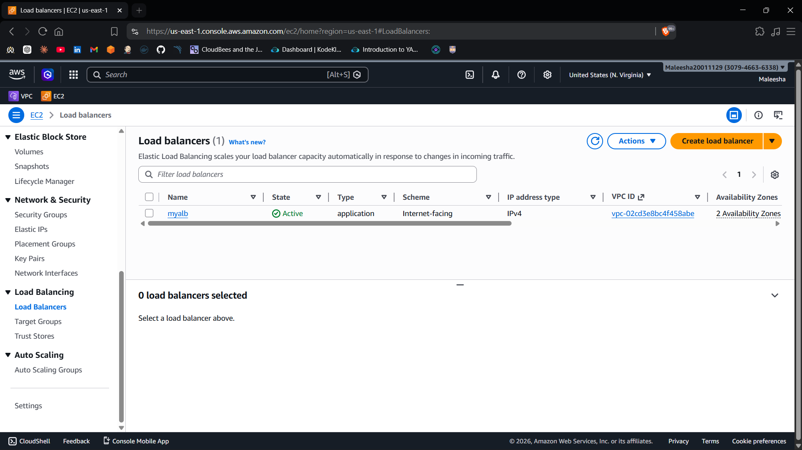
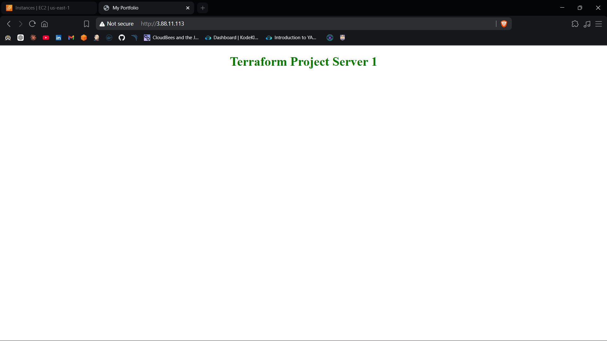
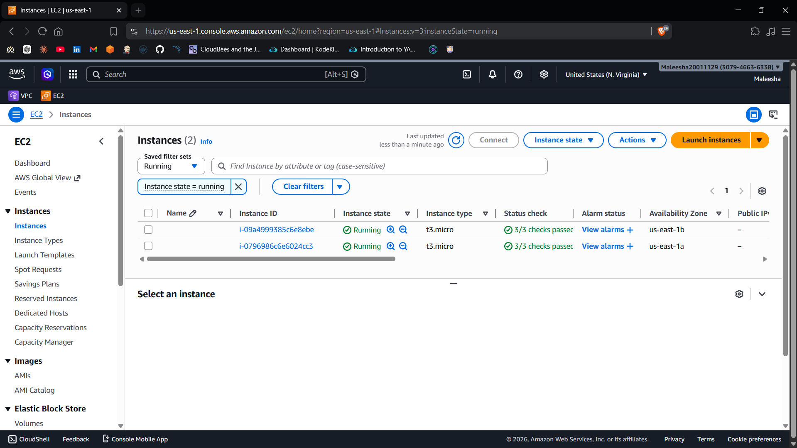

# Terraform Project (AWS)

## Overview

This project uses Terraform to provision a small, internet-facing AWS web stack that demonstrates core networking + load balancing concepts. It creates a VPC with public subnets across two Availability Zones, deploys two EC2 instances running Apache (bootstrapped via `userdata.sh`), and exposes the app through an Application Load Balancer (ALB).

**Traffic flow:** Internet → ALB listener (HTTP/80) → target group → EC2 instances (Apache).

## What this creates

- VPC
- 2 public subnets (in 2 AZs)
- Internet Gateway + route table associations
- Security Group (HTTP/SSH)
- 2 EC2 instances (Apache via `userdata.sh`)
- Application Load Balancer + target group + listener
- S3 bucket

## Configuration

You can override any input using `-var`, environment variables, or a `.tfvars` file.

Common inputs (see `variables.tf` for the full list):

- `aws_region` (default: `us-east-1`)
- `s3_bucket_name` (must be globally unique)
- `allowed_ingress_cidr` (default: `0.0.0.0/0`)
- `instance_ami`, `instance_type`
- `availability_zones`, `subnet_cidrs` (expects exactly two)

## Outputs

- `loadbalancerdns`: DNS name of the created ALB

## Prerequisites

- Terraform installed
- AWS credentials configured (e.g. `aws configure`, environment variables, or an AWS profile)

## How to run

```bash
terraform init
terraform plan
terraform apply
```

After apply, Terraform prints an output named `loadbalancerdns`.

## Verify

- Open `http://<loadbalancerdns>` in your browser.
- You should see the Apache page served by one of the EC2 instances.
- If the page doesn’t load, check ALB target health and confirm the instances finished bootstrapping `userdata.sh`.

## Screenshots

> Screenshots are referenced from `images/`. Keep the filenames the same so they render on GitHub.

### S3 bucket



### VPC



### Target group



### Load balancer



### App page (via public IP / ALB)



### EC2 instances



## Clean up

```bash
terraform destroy
```

## Notes

- Do **not** commit `terraform.tfstate` (it’s ignored via `.gitignore`). If it was committed by accident, remove it from git history.
- `allowed_ingress_cidr` defaults to `0.0.0.0/0` (open to the world). For better security, restrict SSH to your IP/CIDR.
- The S3 bucket name must be globally unique (see `variables.tf`).
- Running these resources can incur AWS charges; destroy them when you’re done.
